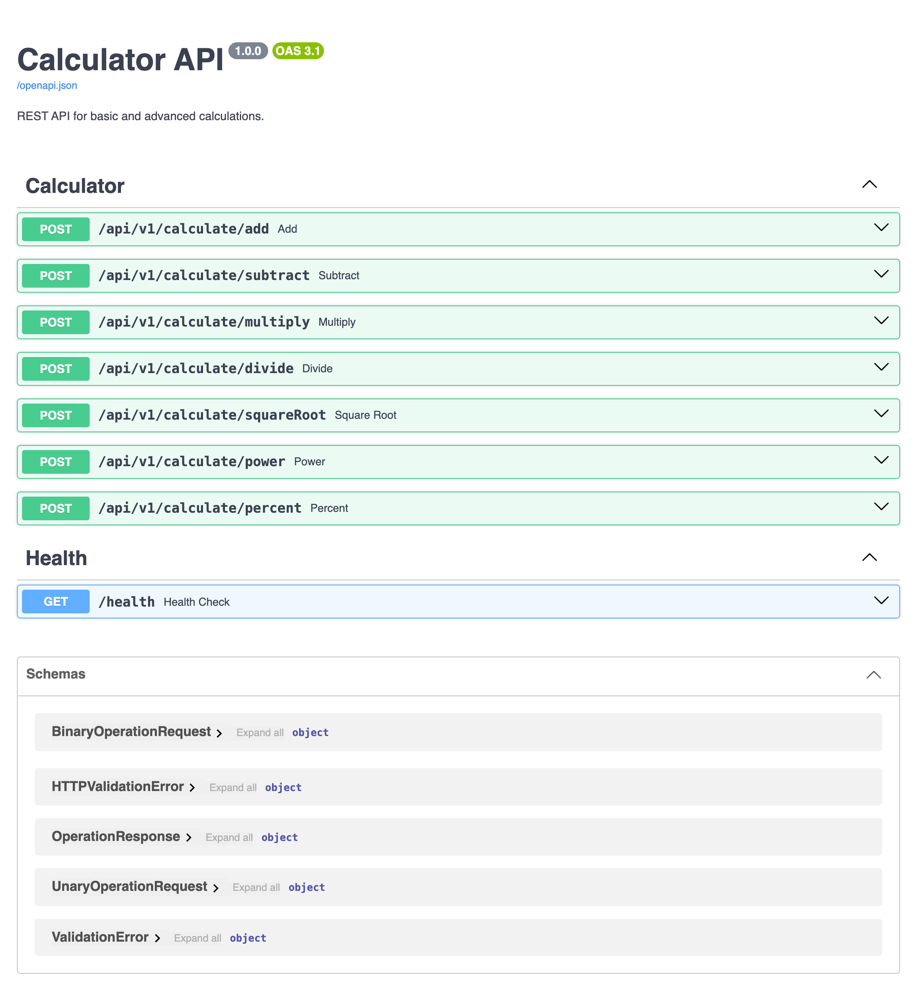
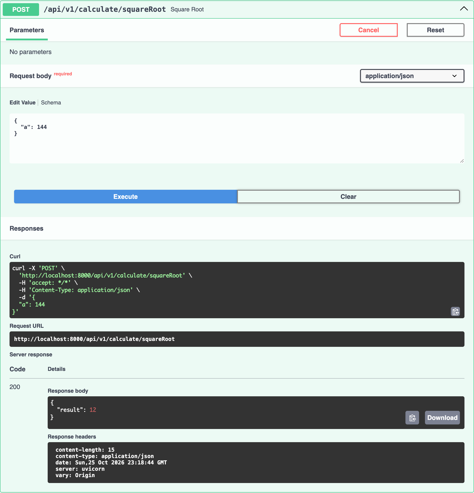
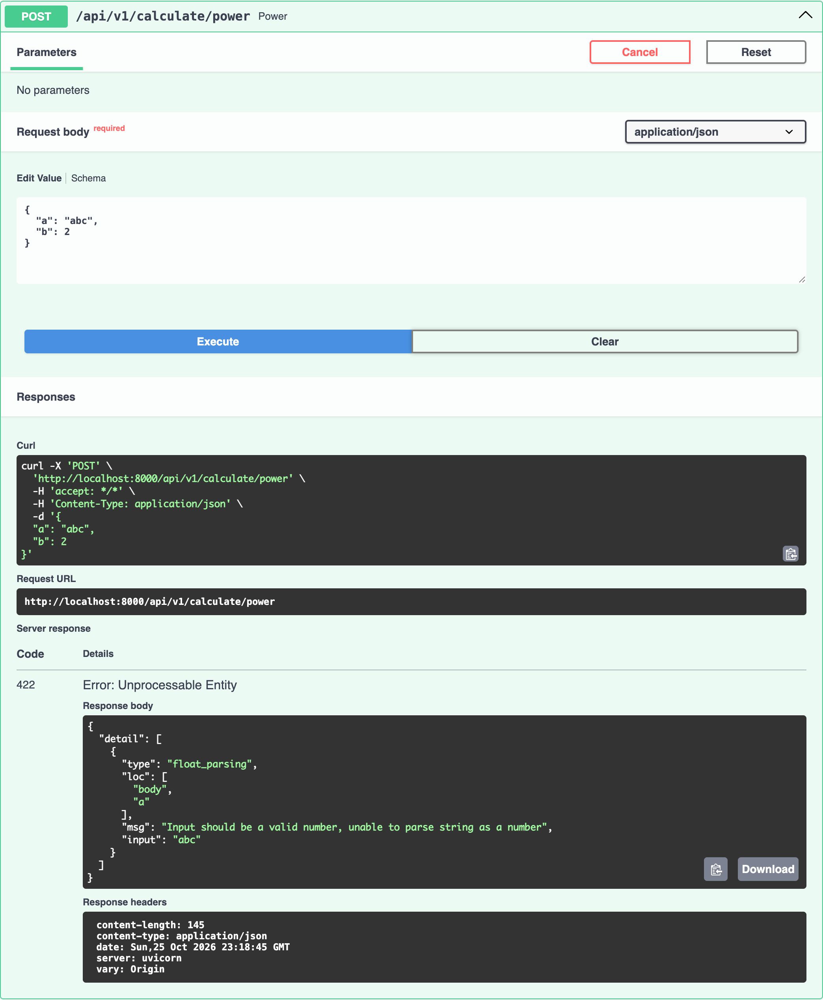

# SuperCalculator: Sezzle Assessment

**Created by:** Juan Carlos Leal Cruz

A full-stack calculator created using **React + TypeScript** frontend that consumes a **Python + FastAPI** REST API. It supports addition, subtraction, multiplication, division, exponentiation, square root and percentage. Both services run in Docker and are built and tested by a GitHub Actions CI pipeline.


## Tech stack
| Layer | Technology |
|---|---|
| Frontend | React 19, TypeScript, Vite, plain CSS |
| Backend | Python 3.12, FastAPI, Pydantic, Uvicorn, managed with `uv`|
| Tests | pytest, pytest-cov, FastAPI `TestClient` |
| Containers | Docker (Multi-stage builds), Docker Compose, nginx for the frontend |
| CI | GitHub Actions |

## Project structure

```
.
├── backend/
│   ├── calculator/
│   │   ├── main.py            # App entry point
│   │   ├── config.py          # Settings
│   │   ├── web/               # HTTP layer: Routes and schemas
│   │   ├── application/       # Use cases: CalculatorService
│   │   └── domain/            # Math functions and Exceptions
│   ├── tests/
│   │   ├── unit/              # Domain and service tests
│   │   └── integration/       # API tests
│   ├── Dockerfile
│   └── pyproject.toml
├── frontend/
│   ├── src/
│   │   ├── App.tsx            # Page layout
│   │   ├── api/               # Fetch client + API error parsing
│   │   ├── hooks/             # useCalculator: API call
│   │   ├── components/        # Cards, erro banner and tabs
│   │   └── types/             # Operation types and the operations list
│   ├── nginx.conf
│   └── Dockerfile
├── docker-compose.yml
└── .github/workflows/ci.yml
```

## Setup instructions
### Option A: Docker (Recommended)
The only requirement is Docker with Docker Compose.

```bash
git clone https://github.com/JuanLeal05/Assesment_Calculator_Juan_Leal.git
```

```bash
cd Assesment_Calculator_Juan_Leal
```

### Option B: Local development
Requirements:

- Python 3.12+ and uv
- Node.js 20.19+ (or 22.12+) and npm

Install the dependencies for each service:

```bash
cd backend && uv sync
```

```bash
cd frontend && npm install
```

## How to run the frontend and backend
### With Docker Compose (Both services)
```bash
docker compose up -d --build
```

| Service | URL |
|---|---|
| Frontend | http://localhost:5173 |
| API | http://localhost:8000 |
| Swagger UI (interactive API docs) | http://localhost:8000/docs |

The frontend container waits for the backend's health check to pass before it starts. To stop everything:

```bash
docker compose down
```

### Locally, without Docker
Backend (from `backend/`), with auto-reload:
```bash
uv run uvicorn calculator.main:app --reload
```

Frontend (from `frontend/`), with the Vite dev server:
```bash
npm run dev
```

Both default to the same URLs as above.

### Configuration
| Variable | Service | Default | Purpose |
|---|---|---|---|
| `CORS_ORIGINS` | backend | `["http://localhost:5173"]` | JSON list of origins allowed to call the API |
| `VITE_API_URL` | frontend (build time) | `http://localhost:8000` | API base URL used by the browser |

## Tests and coverage
The backend has 144 tests at 100% coverage. The build fails if coverage drops below **80%**, a threshold set in `pyproject.toml` (`--cov-fail-under=80`).

| Suite | What it covers |
|---|---|
| `tests/unit/test_calculator.py` | Every math operation (Positive, negative, zero, decimal inputs), every domain exception, result validation |
| `tests/unit/test_calculate_service.py` | The service returns domain results and raises the right error on overflow, complex results, etc. |
| `tests/integration/test_api.py` | Every endpoint returns `200` with `{"result": ...}`, `/health`, CORS, OpenAPI |
| `tests/integration/test_errors.py` | Domain errors result in `400`; missing fields, invalid data, `nan`/`inf`, malformed JSON results in `422`; unknown operation results in `404`; wrong method results in `405` |

Run them locally (from `backend/`):
```bash
uv run pytest
```

Or inside Docker, exactly like the CI does:
```bash
docker build --target test backend
```

**Coverage report:** every CI run uploads the HTML and XML coverage report as a downloadable artifact named `backend-coverage` (On the workflow run page in the Actions tab). It also writes the coverage percentage to the run summary.

## API reference and examples
All operations are `POST` requests under `/api/v1/calculate`, with a JSON body and a JSON response.

| Endpoint | Body | Operation |
|---|---|---|
| `/add` | `{"a": number, "b": number}` | `a + b` |
| `/subtract` | `{"a": number, "b": number}` | `a - b` |
| `/multiply` | `{"a": number, "b": number}` | `a × b` |
| `/divide` | `{"a": number, "b": number}` | `a ÷ b` |
| `/power` | `{"a": number, "b": number}` | `a` raised to `b` |
| `/percent` | `{"a": number, "b": number}` | `b`% of `a`, i.e. `a × b / 100` |
| `/squareRoot` | `{"a": number}` | `√a` |
| `GET /health` | none | `{"status": "ok"}` |

**Responses**
| Status | When | Body |
|---|---|---|
| `200` | Success | `{"result": 15.5}` |
| `400` | Domain error: division by zero, square root of a negative number, zero to a negative power, complex or non-finite result | `{"detail": "Division by zero is not allowed."}` |
| `422` | Invalid request: missing field, non-numeric value, `nan`/`inf`, malformed JSON | FastAPI validation error list |
| `404` / `405` | Unknown operation / wrong HTTP method | FastAPI default |

### Examples (Swagger UI)
All examples below were run from the Swagger UI at http://localhost:8000/docs, where every endpoint can be tried interactively. Each screenshot also shows the equivalent `curl` command.

**Available endpoints**



**Addition:**


**Square root:**



**Division by zero:**


**Invalid data validation error:**



The same call from a terminal:
```bash
curl -X POST http://localhost:8000/api/v1/calculate/add -H "Content-Type: application/json" -d '{"a": 12, "b": 3.5}'
```

## Design decisions and assumptions
### Backend
- **Python + FastAPI instead of Go.** Go was the preferred language, but I chose the stack I know well, to prioritize correctness and maintainability within the time box. FastAPI also gives request validation (Pydantic) and interactive OpenAPI docs for free.
- **Layered architecture: web - application - domain.**
  - `domain/` holds pure math functions and domain exceptions. It has no FastAPI imports, so it's trivial to unit test.
  - `application/` (`CalculatorService`) runs an operation and validates its result.
  - `web/` only translates HTTP to service calls. The service is injected with FastAPI's `Depends`.
- **Errors are modeled in the domain.** All domain errors inherit from one `CalculatorError` base class. A single exception handler in `main.py` turns any of them into a `400` with `{"detail": message}`. Request-shape problems are left to FastAPI's `422`.
- **Edge cases handled explicitly:**
  - Division by zero
  - Square root of a negative number
  - `0` raised to a negative power
  - Overflow (e.g. `10^1000` or `1e308 × 10`)
  - Complex results (Example: `(-8)^0.5`)

  Each returns a clear `400` instead of a `500`.
- **`nan` and `inf` are rejected at the edge** (`allow_inf_nan=False`), so they never reach the domain.
- **Versioned API prefix** (`/api/v1`) So the contract can evolve without breaking clients.
- **Configuration via environment variables** (pydantic-settings), Example: `CORS_ORIGINS`.

### Frontend
- **Small, focused components.** `App.tsx` only lays out the page.
  - `CalculatorCard` owns the form. It changes its title and inputs per operation; square root shows a single input.
  - `OperationTabs` selects the operation.
  - `ErrorBanner` shows errors in a red box above the card.
- **The `useCalculator` hook** encapsulates the API call: Result, error and loading state. It also cancels a pending request if a new one starts, so a slow response can't overwrite a newer result.
- **The API client (`api/calculatorApi.ts`)** turns every failure into a readable message:
  - The API's own `400` message
  - `422` validation details
  - A network error ("Could not reach the calculator service")
- **Input validation happens in the browser too.** Empty or non-numeric inputs are caught before calling the API.
- **Minimal, responsive UI** with plain CSS, light/dark mode following the system setting, and a stacked layout on phones.

### Docker
- **Multi-stage builds.**
  - Backend: `base` (Dependencies), `test` (Runs the suite), `runtime` (Only the app code).
  - Frontend: `build` (Node) and `runtime` (Nginx serving the static files).
- **Production-minded images:** Both run as non-root users, have health checks, and install exact dependency versions from lockfiles (`uv.lock`, `package-lock.json`).
- **The browser calls the API directly**, so `VITE_API_URL` is the API URL as seen from the user's machine, not the container's internal hostname.

### Assumptions
- Percentage means "`b` percent of `a`" (`percent(200, 15) = 30`).
- All inputs and results are floating-point numbers (e.g. `5 + 5` returns `10.0`).
- No authentication or persistence is needed: The API is stateless.

## CI and repository rules
Both were set up to follow clean development practices, even though nothing is deployed yet.

### CI: `.github/workflows/ci.yml`
The CI runs on every pull request and push to `main` and `develop`, with three jobs:

| Job | What it checks |
|---|---|
| `backend-tests` | Builds the backend Docker `test` stage. It fails if any test fails or coverage is below 80%. Uploads the coverage report. |
| `backend-image` | Runs after `backend-tests`. Builds the backend runtime image, starts it, waits until it's healthy, and calls `/health` and `/add`. |
| `frontend-image` | Builds the frontend image (`npm ci` + TypeScript check + Vite build), starts it, and checks the app is served. |

Docker layers are cached between runs, and a new commit cancels the previous run on the same branch.

### Ruleset for `main` and `develop`
A GitHub ruleset protects both branches:
- Changes go through **pull requests**. No direct pushes, force-pushes or branch deletion.
- All three CI jobs above must pass before merging (**required status checks**), and the branch must be up to date with its target.
- Review conversations must be resolved before merging.

The workflow is `feature/*` then PR into `develop` and then PR into `main`.

## Deployment idea: AWS
Nothing is deployed yet, but the project is set up so the CI can grow into a CD pipeline (`cd.yml`) with few changes. The plan targets AWS:

```
                   ┌────────────────────────┐
  Browser ───────▶ │ CloudFront + S3        │  React static build
     │             └────────────────────────┘
     │             ┌────────────────────────┐
     └───────────▶ │ AWS App Runner         │  backend container (from ECR)
                   └────────────────────────┘
```

### Backend. Amazon ECR + AWS App Runner
- The backend's `runtime` image is already production-ready: Non-root, with a health check, serving on port 8000. It's the same image the CI tests in `backend-image`.
- A CD job would push it to **Amazon ECR**, tagged with the commit SHA, and deploy it to **App Runner**. App Runner provides HTTPS, autoscaling and health checks against `/health`.
- `CORS_ORIGINS` would be set to the frontend's CloudFront domain.
- **Alternative:** if App Runner isn't available on the account, **Amazon ECS on Fargate** runs the same image behind an Application Load Balancer.

### Frontend. Amazon S3 + CloudFront
- The frontend is just static files, so it doesn't need a container in production. That's cheaper and simpler.
- The CD job would run `npm run build` with `VITE_API_URL` set to the App Runner URL, upload `dist/` to an **S3** bucket, and serve it through **CloudFront** for HTTPS and caching.
- The frontend Docker image stays useful for local development with Docker Compose.

### CD pipeline sketch
1. Trigger on a push to `main`, only after the CI workflow succeeds.
2. Authenticate to AWS with **GitHub OIDC** and an IAM role, so no long-lived AWS keys are stored in GitHub.
3. Backend: Build the image, push to ECR and deploy the new image to App Runner.
4. Frontend: build with the production `VITE_API_URL`, ync to S3 and invalidate the CloudFront cache.
5. Smoke test the deployed `/health` endpoint and the frontend URL.

Branch protection already guarantees that only code that passed the CI reaches `main`, so the CD would only ever deploy tested images.

## Prompts I used
These are the prompts from my AI-assisted session (Claude Code) that led to changes in the project, in order.
1. **Backend review**
   > So far I've build a simple REST API using Python with FastAPI. I need you to double check the flow, starting from the very first entry of the API in main.py, then continue with the web layer, then the application and finally the domain part. I need you to tell me if the flow is complete or if it leaks at some point. Check the flow and if the API is perfectly configured

2. **Backend fixes**
   > Ok, let's start by patching the blockers, then the leaks and then the configuration gaps.

3. **Backend test suite**
   > I want your help to create the proper tests as follows:
   > * Unit tests: Validate the whole mathematic logic
   > * API integrations test: Validate that FastAPI is correctly receiving the requests, executing the operations and returning the result to the user
   > * Error handling and validation test: Check what happens if parameters are missing, invalid data is sent, an unknown operation is requested, or an attempt is made to divide by zero (And any of the other exceptions).
   >
   > I created a new branch so that later I can merge it just to be cleaner. Do not merge or create a PR.

4. **Backend Dockerfile**
   > As of right now, I feel like we need to move with the Dockerfile for the Backend. My idea is later to create a docker-compose that runs two containers: One for the front and other for the back so that I can access localhost:5173 and see the front thatwill consume the API. In order to do so I need to execute both containers at the same time, that's what the docker-compose.yml will do later on.

5. **Backend CI**
   > Now, let's create the CI.yml file in order to finish up the Backend part. In this .yml for now, we'll build the Docker container for the Backend and we'll check the coverage so that it can be merged into develop. This CI is the first step of what will evolve into a CD.yml later in case anything gets deployed

6. **Frontend**
   > Now let's create a pretty simple but functional frontend, a simple page with a title like "SuperCalculator" and right below it, there will be a card where the user will generate his input and the button with which he'll execute the operation. The idea is that the card changes across the multiple operations. The front must capture the errors given by the API and show them to the user by placing a simple red rectangle above the card. I want a minimalistic frontend and make sure to divide the folder accordingly so that App.tsx is not overloaded, you must create a hook using TypeScript that has to handle the API call and will be called inside the component

7. **Frontend Dockerfile and docker-compose**
   > Let's create the Dockerfile for the front so that it can be used alongside the backend with a docker-compose that will execute both containers. Wirte the docker-compose.yml in the root folder so that it can be executed using docker compose up -d --build making that the front is accessible and the API as well.

8. **Frontend in the CI**
   > Now let's add the front to the CI.yml so the check would be to verify if the frontend container is created successfully
